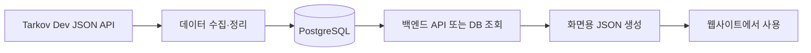

# 타르코프 도서관 · Airflow

**갱신일: 26.10.20**

[타르코프 도서관](https://eftlibrary.com)에서 사용하는 게임 데이터를 주기적으로 갱신하는 프로젝트입니다.

아이템 가격, 퀘스트, 지도, 보스 정보는 게임 업데이트에 따라 달라집니다. 이 저장소는 외부 API에서 데이터를 가져와 서비스에 맞게 정리하고, 데이터베이스에 저장하는 일을 맡습니다. 화면에서 사용할 JSON 파일을 만들고, DB를 백업하며, 서비스 상태를 확인하는 작업도 함께 관리합니다.

작업을 정해진 시간에 실행하고 실행 결과를 확인하기 위해 **Apache Airflow**를 사용합니다.

## 전체 서비스에서 맡은 역할

아래 그림은 타르코프 도서관의 전체 구성입니다. 이 저장소는 그중 데이터 수집과 정기 작업을 담당하는 Airflow에 해당합니다.


주요 데이터 출처는 Tarkov Dev의 JSON API(`https://json.tarkov.dev`)입니다. 수집한 데이터를 바탕으로 서비스에서 필요한 설명이나 번역을 보완합니다.

## 데이터가 화면에 전달되기까지

크게 두 단계로 나누어 볼 수 있습니다.



### 1. 데이터를 가져와 DB에 저장합니다

아이템 정보를 예로 들면 다음 순서로 진행됩니다.

1. 외부 API에서 아이템 목록을 가져옵니다.
2. 받은 내용을 임시 JSON 파일로 저장합니다.
3. 아이템의 기본 정보, 탄약 성능, 회복 효과 등을 테이블에 맞게 나눕니다.
4. DB에 새 데이터를 추가하거나 기존 데이터를 갱신합니다.
5. 사용한 임시 파일을 정리합니다.

코드에서 자주 보이는 **upsert**는 “이미 있으면 수정하고, 없으면 추가한다”는 뜻입니다. 언어별 데이터가 필요한 작업은 영어·한국어·일본어 응답을 함께 활용하며, 일부 설명은 코드에서 보완합니다.

### 2. 화면에서 사용할 JSON 파일을 만듭니다

수집한 데이터를 저장하는 것과 웹사이트에 전달할 파일을 만드는 것은 별도 작업입니다.

`*_static_json.py` 파일은 백엔드 API나 DB에서 데이터를 읽어 화면에 필요한 형태의 JSON 파일을 만듭니다. 생성한 파일은 웹사이트에서 사용할 수 있도록 `/opt/airflow/next-public` 아래에 저장합니다.

예를 들어 아이템 가격은 **가격 수집과 DB 저장이 성공한 뒤** 가격 JSON 생성 작업을 이어서 실행합니다. 다른 JSON 생성 작업은 각 파일에 정의된 일정에 따라 실행됩니다.

## 정의 되어 있는 작업들

| 작업                 | 담당 파일                                                       | 하는 일                                              |
| -------------------- | --------------------------------------------------------------- | ---------------------------------------------------- |
| 게임 정보 갱신       | `v3_dags_item.py`, `v3_dags_quest.py`, `v3_dags_map.py` 등      | 아이템·퀘스트·지도·보스·은신처·상인 정보 갱신        |
| 아이템 가격 갱신     | `v3_dags_item_price.py`                                         | PVP·PVE·시즌 가격 저장 및 오래된 일반 가격 이력 정리 |
| 지도 위치 정보 갱신  | `v3_dags_live_map_point.py`, `v3_dags_live_map_static_point.py` | 퀘스트 관련 위치와 고정 지점 정보 갱신               |
| 프레스티지 정보 갱신 | `v3_dags_prestige.py`                                           | 조건·보상 등 프레스티지 정보 갱신                    |
| 검색 자동완성 갱신   | `v3_dags_autocomplete.py`                                       | 검색에 사용하는 자동완성 데이터 갱신                 |
| 화면용 JSON 생성     | `v3_dags_*_static_json.py`                                      | 아이템·지도·홈·검색 등 화면별 JSON 생성              |
| DB 백업              | `dags_data_dump.py`                                             | 선택한 테이블을 SQL 파일로 백업하고 압축             |
| 서비스 상태 확인     | `dags_health_check.py`                                          | 서비스 상태와 응답 시간을 확인하고 기록              |

각 파일은 [dags](dags) 폴더에서 확인할 수 있습니다. `v3_initial_dags_*.py`는 초기 적재용이며 자동 실행 일정 없이 수동으로 실행합니다. 정기 갱신용 DAG와 구분해서 사용합니다.

## 디렉토리 구조

```text
.
├── dags/                       # 실행 일정과 작업 순서
├── plugins/
│   ├── custom_module/
│   │   ├── tarkov_json_api.py   # 외부 게임 데이터 API 호출
│   │   ├── static_api_client.py # 화면용 JSON 생성 시 API 요청 간격·재시도 처리
│   │   ├── data_dump_func.py    # 백업 대상 목록과 셸 명령 생성
│   │   ├── dag_failure_alert.py # DAG 실패 감시와 메일 알림
│   │   ├── queries/            # 데이터 종류별 SQL
│   │   └── *_task_func.py       # API 응답을 DB 저장 형태로 정리하는 함수
│   └── script/                 # 서비스 상태 확인용 셸 스크립트
├── tests/                      # 회귀 테스트
└── airflow.md                  # 과거 Airflow 설치 기록
```

SQL은 `plugins/custom_module/queries/`에서 아이템·퀘스트·가격 등 데이터 종류별로 관리합니다. 초기 적재와 정기 갱신 DAG는 같은 쿼리 모듈을 사용합니다. DB 연결, 파라미터 전달, 트랜잭션 처리는 호출하는 DAG에서 담당합니다.

## 실행 환경과 설정

운영 환경은 **Python 3.13, Airflow 3.1.5, PostgreSQL**을 사용합니다.

이 저장소는 운영 중인 Airflow에 DAG와 공통 모듈을 배치하는 구조입니다. 로컬에서 실행하려면 Airflow와 관련 provider 패키지, DB 연결, 파일 저장 경로를 별도로 준비해야 합니다.

| 설정                                | 용도                                                   |
| ----------------------------------- | ------------------------------------------------------ |
| Airflow Connection `platform_db`    | 데이터 수집·조회 작업에서 사용하는 PostgreSQL 연결     |
| Airflow Connection `smtp_gmail`     | 실패·서비스 이상·데이터 변경 알림에 사용하는 메일 연결 |
| Airflow Connection `rustfs_storage` | 압축한 DB 백업을 RustFS의 `postgresql` 버킷에 업로드   |
| `/opt/airflow/tmp`                  | 수집한 응답을 잠시 보관하는 경로                       |
| `/opt/airflow/next-public`          | 화면용 JSON 출력 경로                                  |
| `/opt/airflow/latest_data`          | DB 백업과 서비스 상태 확인 로그 저장 경로              |

DB 백업은 별도로 `pg_dump` 명령을 사용하므로 [백업 모듈](plugins/custom_module/data_dump_func.py)의 접속 대상과 실행 계정의 PostgreSQL 인증 설정도 확인해야 합니다. 저장 경로에는 작업을 실행하는 계정의 쓰기 권한이 필요합니다.

## 운영할 때 알아두면 좋은 내용

### 시즌 가격은 따로 보관합니다

가격 수집은 PVP, PVE, `pvp-season` 세 가지를 다룹니다. 시즌 정보와 가격을 검증한 뒤 한 트랜잭션으로 저장합니다. 트랜잭션은 여러 DB 변경을 하나로 묶어, 중간에 실패하면 일부만 반영되지 않도록 하는 방식입니다.

일반 PVP·PVE 가격 이력은 14일이 지난 데이터를 정리하고, 이전 시즌의 가격과 시즌 이력은 보존합니다. 화면용 가격 JSON에는 현재 시즌을 담고, 지난 시즌 가격은 백엔드 API로 조회합니다.

시즌 가격 수집을 처음 적용하는 DB에는 백엔드의 `sql/migrations/20261007_price_seasons.sql`을 먼저 적용해야 합니다. DB 구조를 준비한 뒤 가격 수집을 실행하고, 저장 결과와 JSON 생성을 확인합니다.

### 백업은 필요한 테이블을 선택합니다

백업 대상은 [data_dump_func.py](plugins/custom_module/data_dump_func.py)의 `DATA_DUMP_TABLES`에서 관리합니다.

- **포함:** 게임 기준 데이터, 배틀패스·BTR 경로, 현재 가격과 시즌 정보, 사용자 저장 데이터, 운영 공지, 내 위치 찾기 배포 정보·맵 별칭, 파티 방·멤버·마커, 채팅 차단·제재·초대 수신 설정
- **제외:** 가격 이력, 접속·요청·분석 로그, 채팅 메시지와 메시지 신고, 접속 기록, 파티 초대 이력
- **기존 유지:** 커뮤니티 신고·제재·조회·알림 데이터

채팅 사용자 식별자는 차단·제재·수신 설정에서 참조하므로 함께 백업합니다. 메시지 신고는 제외된 채팅 메시지를 참조하므로 함께 제외합니다.

백업이 성공하면 SQL 파일을 gzip으로 압축하고, `rustfs_storage` 연결로 `postgresql` 버킷의 루트에 `YYYY_MM_DD_backup.sql.gz` 이름으로 업로드합니다. 날짜는 DAG 실행 시작 시각(Asia/Seoul)을 기준으로 하며, 같은 날짜의 재업로드는 기존 객체를 덮어씁니다. 업로드는 실패 시 최대 2회 재시도하고, 성공한 뒤에만 저장 폴더에서 `find -mtime +2` 조건에 해당하는 오래된 파일을 삭제합니다. 버킷에 올린 백업은 이 작업에서 삭제하지 않습니다.

실행 환경에 `apache-airflow-providers-amazon`이 필요합니다. `rustfs_storage`는 Amazon Web Services 유형으로 만들고 Login/Password에 RustFS Access Key/Secret Key를 설정합니다. Extra에는 `endpoint_url`을 `http://172.30.1.100:9000`으로 지정하고, 필요하면 `region_name`과 `config_kwargs.s3.addressing_style`을 각각 `us-east-1`, `path`로 설정합니다. 해당 키에는 비공개 `postgresql` 버킷의 객체 조회 및 업로드 권한이 필요합니다. 압축 작업과 업로드 작업을 실행하는 워커는 같은 `/opt/airflow/latest_data` 경로를 공유해야 합니다.

**전체 DB 백업은 아니므로 제외한 데이터는 이 백업으로 복구할 수 없습니다.**

### 작업이 실패하면 메일로 알립니다

DAG 실행이 최종 실패하면 `smtp_gmail` 연결을 통해 운영자에게 메일을 보냅니다. 메일에는 DAG 이름, 실행 ID, 시작·종료 시간과 실패 사유가 담깁니다.

Airflow UI에서는 해당 실행의 실패한 Task 로그부터 확인하면 됩니다. 임시 파일 정리가 성공했더라도 앞선 작업의 실패가 가려지지 않도록 `watch_dag_failure` Task가 감시합니다.

새 DAG를 추가할 때는 다음 두 설정을 함께 적용합니다.

1. DAG에 `on_failure_callback=send_dag_failure_email`을 지정합니다.
2. 모든 Task를 정의한 뒤 `add_failure_watcher(dag)`를 호출합니다.

구현은 [dag_failure_alert.py](plugins/custom_module/dag_failure_alert.py)에 있습니다. UI나 CLI에서 수동으로 실패 상태를 지정하면 콜백은 실행되지 않으며, 메일 전송 자체의 오류는 DAG processor 로그에서 확인합니다.

## AIOps 정기 로그 수집

`dags_aiops_collect`는 **5분마다** `POST /v1/collect`에 `{}`를 보내 로그를 수집합니다.
Connection `aiops`와 Variable `AIOPS_API_TOKEN`을 공유하며 보고서 요청이나 Worker는 호출하지 않습니다.
`max_active_runs=1`, `catchup=False`로 실행합니다. 최종 실패 시 기존 메일 알림을 사용합니다.
`collect` 태스크 로그에 응답의 `status`, 서비스별 `coverage`, `database_registration`을 남깁니다.
HTTP 200의 `status=partial`은 경고로 표시하고 수집 태스크는 성공 처리합니다.
배치 정보 등록은 AIOps 서버가 담당합니다.

일일 DAG의 분석 전 수집도 유지합니다. 정기 수집은 5분마다, 일일 분석은 하루 한 번 실행됩니다.

## AIOps 일일 보고서

`dags_aiops_daily`는 매일 **한국 시간 오전 1시**에 전날 보고서를 만듭니다.
`check_status → collect → submit_report → run_until_completed` 순서로 실행하며,
접수한 `job_id`가 `COMPLETED`일 때만 성공합니다. 기존 DAG와 같은 실패 메일을 사용합니다.

Airflow UI에서 다음 Connection을 먼저 생성합니다.

| 항목 | 값 |
| --- | --- |
| Connection ID | `aiops` |
| Connection Type | `HTTP` |
| Extra | `{"base_url":"http://172.30.1.100:9023","worker_timeout":900}` |

Airflow Variable `AIOPS_API_TOKEN`에 운영 AIOps의 토큰 값을 저장합니다.
실행 시 Variable에서 읽어 모든 요청의 `X-AIOps-Key` 헤더로 보냅니다. Connection Password는 사용하지 않습니다.
주소는 Extra의 `base_url`을 사용하며, 생략하면 위 주소를 사용합니다.
키는 코드·Git·실행 설정 JSON에 넣지 않습니다. 추가 HTTP provider 없이 기존 `requests`로 호출합니다.
DAG 배포 전 Airflow 태스크 실행 컨테이너에서 해당 주소의 `/v1/status`에 인증된 요청이 가능한지 확인합니다.

수동 실행 시 `{"date":"2026-10-27"}`처럼 날짜를 지정할 수 있습니다.
날짜를 생략한 수동 실행은 실행 시작일의 전날, 정기 실행은 데이터 구간 종료일의 전날을 사용합니다.
재시도·태스크 재실행에도 이 기준은 유지됩니다. 미마감 기간과 데이터 없음(422)은 실패 처리합니다.
수집이 부분 성공이면 경고를 남기고 보고서를 진행하므로 보고서의 coverage를 함께 확인해야 합니다.

Worker는 `POST /v1/worker/run-once/stream`의 SSE 응답을 실시간 수신합니다.
일일·주간·월간 모두 `run_until_completed` 태스크의 Logs에서 Codex 공개 메시지,
제공된 토큰 사용량, 분석 요약, 실행 상태와 heartbeat를 확인할 수 있습니다.
중간 공개 메시지가 없으면 상태와 heartbeat만 표시됩니다. 내부 사고 과정은 전달하지 않습니다.
스트림 종료 후에도 원래 대상 `job_id`를 조회하여 `COMPLETED`인지 확인합니다.
스트림 단절·최종 이벤트 누락은 다음 Sensor 실행에서 대상 상태부터 다시 확인합니다.
새 스트리밍 API가 배포되어 있어야 하며, 404이면 태스크가 실패합니다.

스트림 read timeout은 heartbeat 기준 45초이며, 전체 수신은 `worker_timeout`(기본 900초)으로 제한합니다.
전체 제한은 이벤트를 수신할 때 확인하므로 무응답 시 read timeout만큼 늦어질 수 있습니다. 서버 분석 제한을 늘리면 `worker_timeout`과
Sensor의 `execution_timeout`(20분)을 함께 조정합니다. Sensor는 최대 3시간 동안 60초 간격으로
대상 작업을 조회하고 큐의 Worker 한 건을 실행합니다. 대기 사이에는 `reschedule`로 실행 슬롯을 반환합니다.
409·일시적인 서버 오류·연결 끊김은 다음 조회에서 같은 작업을 확인합니다.
서버의 재시도 예약은 DB 큐가 관리하며, 다른 작업을 처리했거나 `idle`을 반환해도 대상 작업 완료로 간주하지 않습니다.
`FAILED`·`TIMEOUT`·`CANCELLED` 및 인증 오류는 실패 처리합니다.

### 주간·월간 보고서

| DAG | 한국 시간 일정 | 대상 |
| --- | --- | --- |
| `dags_aiops_weekly` | 월요일 오전 1시 | 지난주 월~일 일일 보고서 |
| `dags_aiops_monthly` | 매월 1일 오전 1시 | 지난달 일일 보고서 |

두 DAG는 `wait_for_daily → check_status → submit_report → run_until_completed` 순서로 실행합니다.
마감일의 일일 분석(주간은 일요일, 월간은 말일)을 담당하는 정기 `dags_aiops_daily`의
`run_until_completed` 성공을 최대 4시간 기다립니다. 해당 태스크가 실패하거나 건너뛰면 상위 보고서도 실패합니다.
일일 DAG를 함께 활성화해야 하며, 수동으로 실행한 일일 DAG는 정기 실행의 대체로 인식하지 않습니다.

별도 원본 수집 없이 `weekly`·`monthly` 보고서를 요청합니다. 두 작업은 서로 기다리지 않으며,
같은 날짜에 실행되어 Worker 잠금이 충돌하면 기존 재확인 흐름으로 처리합니다.
기간 중 다른 날짜의 보고서 누락 여부는 AIOps에서 판단하고 불완전 보고서로 표시합니다.
모든 날짜의 완전성을 Airflow가 보장하는 것은 아닙니다.

정기 실행은 데이터 구간 종료 시점을 기준으로 지난주 월요일·지난달 1일을 요청 날짜로 고정합니다.
세 DAG에 `CronDataIntervalTimetable`을 명시하여 일일 의존 실행의 논리 날짜를 일관되게 계산합니다.
수동 실행에서는 `{"date":"2026-10-15"}`처럼 대상 주·월에 속하는 날짜를 지정할 수 있습니다.
이 경우에도 해당 기간 마지막 날의 정기 일일 분석 성공을 기다리므로, 과거 정기 실행이 없으면 대기 후 실패합니다.
Connection `aiops`와 Variable `AIOPS_API_TOKEN`은 일일 DAG와 공유합니다.

로컬 검증 명령은 다음과 같습니다.

```sh
uv run --with requests --with pendulum python -m unittest discover -s tests -v
```

## 개발 기록

구현 과정과 시행착오는 [Airflow 개발 기록](https://velog.io/@poeynus/series/Airflow-%EA%B0%9C%EB%B0%9C)에 정리하고 있습니다.

여기서 확인해주세용 !!!
