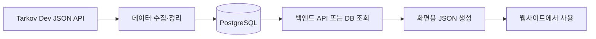

# 타르코프 도서관 · Airflow

**갱신일: 26.10.20**

[타르코프 도서관](https://eftlibrary.com)에서 사용하는 게임 데이터를 주기적으로 갱신하는 프로젝트입니다.

아이템 가격, 퀘스트, 지도, 보스 정보는 게임 업데이트에 따라 달라집니다. 이 저장소는 외부 API에서 데이터를 가져와 서비스에 맞게 정리하고, 데이터베이스에 저장하는 일을 맡습니다. 화면에서 사용할 JSON 파일을 만들고, DB를 백업하며, 서비스 상태를 확인하는 작업도 함께 관리합니다.

작업을 정해진 시간에 실행하고 실행 결과를 확인하기 위해 **Apache Airflow**를 사용합니다.

## 전체 서비스에서 맡은 역할

아래 그림은 타르코프 도서관의 전체 구성입니다. 이 저장소는 그중 데이터 수집과 정기 작업을 담당하는 Airflow에 해당합니다.


주요 데이터 출처는 Tarkov Dev의 JSON API(`https://json.tarkov.dev`)입니다. 수집한 데이터를 바탕으로 서비스에서 필요한 설명이나 번역을 보완합니다.

## 데이터가 화면에 전달되기까지

크게 두 단계로 나누어 볼 수 있습니다.



### 1. 데이터를 가져와 DB에 저장합니다

아이템 정보를 예로 들면 다음 순서로 진행됩니다.

1. 외부 API에서 아이템 목록을 가져옵니다.
2. 받은 내용을 임시 JSON 파일로 저장합니다.
3. 아이템의 기본 정보, 탄약 성능, 회복 효과 등을 테이블에 맞게 나눕니다.
4. DB에 새 데이터를 추가하거나 기존 데이터를 갱신합니다.
5. 사용한 임시 파일을 정리합니다.

코드에서 자주 보이는 **upsert**는 “이미 있으면 수정하고, 없으면 추가한다”는 뜻입니다. 언어별 데이터가 필요한 작업은 영어·한국어·일본어 응답을 함께 활용하며, 일부 설명은 코드에서 보완합니다.

### 2. 화면에서 사용할 JSON 파일을 만듭니다

수집한 데이터를 저장하는 것과 웹사이트에 전달할 파일을 만드는 것은 별도 작업입니다.

`*_static_json.py` 파일은 백엔드 API나 DB에서 데이터를 읽어 화면에 필요한 형태의 JSON 파일을 만듭니다. 생성한 파일은 웹사이트에서 사용할 수 있도록 `/opt/airflow/next-public` 아래에 저장합니다.

정기 JSON 생성은 한국 시간 03:00~04:00에 5분 간격으로 실행합니다. 아래 이름은 `dags_{이름}_static_json`의 이름 부분입니다.

| JSON | 실행 시각 (Asia/Seoul) |
| --- | --- |
| `live_map` | 03:00 |
| `quest` | 03:05 |
| `roadmap` | 03:10 |
| `map` | 03:15 |
| `story` | 03:20 |
| `home` | 03:25 |
| `search` | 03:30 |
| `news` | 03:35 |
| `boss` | 03:40 |
| `map_of_tarkov` | 03:45 |
| `progress` | 03:50 |
| `hideout` | 03:55 |
| `item` | 04:00 |

가격 JSON은 별도 정기 일정 없이 매시간 가격 수집 DAG의 DB 저장 성공 후 실행합니다. 다른 JSON 생성은 원천 수집 완료를 기다리지 않으므로, 원천 수집이 지연되거나 실패하면 기존 데이터가 반영될 수 있습니다. 5분 간격은 시작 시각의 분산이며 이전 생성 작업의 완료를 보장하지 않습니다.

예를 들어 아이템 가격은 **가격 수집과 DB 저장이 성공한 뒤** 가격 JSON 생성 작업을 이어서 실행합니다. 다른 JSON 생성 작업은 각 파일에 정의된 일정에 따라 실행됩니다.

## 정의 되어 있는 작업들

| 작업                 | 담당 파일                                                       | 하는 일                                              |
| -------------------- | --------------------------------------------------------------- | ---------------------------------------------------- |
| 게임 정보 갱신       | `dags_item.py`, `dags_quest.py`, `dags_map.py` 등      | 아이템·퀘스트·지도·보스·은신처·상인 정보 갱신        |
| 아이템 가격 갱신     | `dags_item_price.py`                                         | PVP·PVE·시즌 가격 저장 및 오래된 일반 가격 이력 정리 |
| 지도 위치 정보 갱신  | `dags_live_map_point.py`, `dags_live_map_static_point.py` | 퀘스트 관련 위치와 고정 지점 정보 갱신               |
| 프레스티지 정보 갱신 | `dags_prestige.py`                                           | 조건·보상 등 프레스티지 정보 갱신                    |
| 검색 자동완성 갱신   | `dags_autocomplete.py`                                       | 검색에 사용하는 자동완성 데이터 갱신                 |
| 화면용 JSON 생성     | `dags_*_static_json.py`                                      | 아이템·지도·홈·검색 등 화면별 JSON 생성              |
| DB 백업              | `dags_data_dump.py`                                             | 선택한 테이블을 SQL 파일로 백업하고 압축             |
| 서비스 상태 확인     | `dags_health_check.py`                                          | 서비스 상태와 응답 시간을 확인하고 기록              |

각 파일은 [dags](dags) 폴더에서 확인할 수 있습니다. `initial_dags_*.py`는 초기 적재용이며 자동 실행 일정 없이 수동으로 실행합니다. 정기 갱신용 DAG와 구분해서 사용합니다.

## 디렉토리 구조

```text
.
├── dags/                       # 실행 일정과 작업 순서
├── plugins/
│   ├── custom_module/
│   │   ├── tarkov_json_api.py   # 외부 게임 데이터 API 호출
│   │   ├── static_api_client.py # 화면용 JSON 생성 시 API 요청 간격·재시도 처리
│   │   ├── data_dump_func.py    # 백업 대상 목록과 셸 명령 생성
│   │   ├── dag_failure_alert.py # DAG 실패 감시와 메일 알림
│   │   ├── queries/            # 데이터 종류별 SQL
│   │   └── *_task_func.py       # API 응답을 DB 저장 형태로 정리하는 함수
│   └── script/                 # 서비스 상태 확인용 셸 스크립트
├── tests/                      # 회귀 테스트
└── airflow.md                  # 과거 Airflow 설치 기록
```

SQL은 `plugins/custom_module/queries/`에서 아이템·퀘스트·가격 등 데이터 종류별로 관리합니다. 초기 적재와 정기 갱신 DAG는 같은 쿼리 모듈을 사용합니다. DB 연결, 파라미터 전달, 트랜잭션 처리는 호출하는 DAG에서 담당합니다.

## 실행 환경과 설정

운영 환경은 **Python 3.13, Airflow 3.1.5, PostgreSQL**을 사용합니다.

이 저장소는 운영 중인 Airflow에 DAG와 공통 모듈을 배치하는 구조입니다. 로컬에서 실행하려면 Airflow와 관련 provider 패키지, DB 연결, 파일 저장 경로를 별도로 준비해야 합니다.

| 설정                                | 용도                                                   |
| ----------------------------------- | ------------------------------------------------------ |
| Airflow Connection `platform_db`    | 데이터 수집·조회 작업에서 사용하는 PostgreSQL 연결     |
| Airflow Connection `smtp_gmail`     | 실패·서비스 이상·데이터 변경 알림에 사용하는 메일 연결 |
| Airflow Connection `rustfs_storage` | 압축한 DB 백업을 RustFS의 `postgresql` 버킷에 업로드   |
| `/opt/airflow/tmp`                  | 수집한 응답을 잠시 보관하는 경로                       |
| `/opt/airflow/next-public`          | 화면용 JSON 출력 경로                                  |
| `/opt/airflow/latest_data`          | DB 백업과 서비스 상태 확인 로그 저장 경로              |

DB 백업은 별도로 `pg_dump` 명령을 사용하므로 [백업 모듈](plugins/custom_module/data_dump_func.py)의 접속 대상과 실행 계정의 PostgreSQL 인증 설정도 확인해야 합니다. 저장 경로에는 작업을 실행하는 계정의 쓰기 권한이 필요합니다.

## 운영할 때 알아두면 좋은 내용

### 아이템 이름도 한국어·일본어로 갱신합니다

일일 `dags_item`은 기본 정보·속성·분류를 영어 데이터로 처리하고,
한국어·일본어는 아이템 ID별 이름만 추출해 `items.name_ko`, `items.name_ja`를 갱신합니다.
번역 이름이 누락되거나 빈 값이면 기존 DB 이름을 유지합니다. 설명 등 다른 번역 필드는 갱신하지 않습니다.
기존 이름도 매일 API 번역으로 갱신하므로 수동 수정한 이름은 API 값으로 덮어쓸 수 있습니다.

### 시즌 가격은 따로 보관합니다

가격 수집은 PVP, PVE, `pvp-season` 세 가지를 다룹니다. 시즌 정보와 가격을 검증한 뒤 한 트랜잭션으로 저장합니다. 트랜잭션은 여러 DB 변경을 하나로 묶어, 중간에 실패하면 일부만 반영되지 않도록 하는 방식입니다.

일반 PVP·PVE 가격 이력은 14일이 지난 데이터를 정리하고, 이전 시즌의 가격과 시즌 이력은 보존합니다. 화면용 가격 JSON에는 현재 시즌을 담고, 지난 시즌 가격은 백엔드 API로 조회합니다.

시즌 가격 수집을 처음 적용하는 DB에는 백엔드의 `sql/migrations/20261007_price_seasons.sql`을 먼저 적용해야 합니다. DB 구조를 준비한 뒤 가격 수집을 실행하고, 저장 결과와 JSON 생성을 확인합니다.

### 백업은 필요한 테이블을 선택합니다

백업 대상은 [data_dump_func.py](plugins/custom_module/data_dump_func.py)의 `DATA_DUMP_TABLES`에서 관리합니다.

- **포함:** 게임 기준 데이터, 배틀패스·BTR 경로, 현재 가격과 시즌 정보, 사용자 저장 데이터, 운영 공지, 내 위치 찾기 배포 정보·맵 별칭, 파티 방·멤버·마커, 채팅 차단·제재·초대 수신 설정
- **제외:** 가격 이력, 접속·요청·분석 로그, 채팅 메시지와 메시지 신고, 접속 기록, 파티 초대 이력
- **기존 유지:** 커뮤니티 신고·제재·조회·알림 데이터

채팅 사용자 식별자는 차단·제재·수신 설정에서 참조하므로 함께 백업합니다. 메시지 신고는 제외된 채팅 메시지를 참조하므로 함께 제외합니다.

백업이 성공하면 SQL 파일을 gzip으로 압축하고, `rustfs_storage` 연결로 `postgresql` 버킷의 루트에 `YYYY_MM_DD_backup.sql.gz` 이름으로 업로드합니다. 날짜는 DAG 실행 시작 시각(Asia/Seoul)을 기준으로 하며, 같은 날짜의 재업로드는 기존 객체를 덮어씁니다. 업로드는 실패 시 최대 2회 재시도하고, 성공한 뒤에만 저장 폴더에서 `find -mtime +2` 조건에 해당하는 오래된 파일을 삭제합니다. 버킷에 올린 백업은 이 작업에서 삭제하지 않습니다.

실행 환경에 `apache-airflow-providers-amazon`이 필요합니다. `rustfs_storage`는 Amazon Web Services 유형으로 만들고 Login/Password에 RustFS Access Key/Secret Key를 설정합니다. Extra에는 `endpoint_url`을 `http://172.30.1.100:9000`으로 지정하고, 필요하면 `region_name`과 `config_kwargs.s3.addressing_style`을 각각 `us-east-1`, `path`로 설정합니다. 해당 키에는 비공개 `postgresql` 버킷의 객체 조회 및 업로드 권한이 필요합니다. 압축 작업과 업로드 작업을 실행하는 워커는 같은 `/opt/airflow/latest_data` 경로를 공유해야 합니다.

**전체 DB 백업은 아니므로 제외한 데이터는 이 백업으로 복구할 수 없습니다.**

### 작업이 실패하면 메일로 알립니다

DAG 실행이 최종 실패하면 `smtp_gmail` 연결을 통해 운영자에게 메일을 보냅니다. 메일에는 DAG 이름, 실행 ID, 시작·종료 시간과 실패 사유가 담깁니다.

Airflow UI에서는 해당 실행의 실패한 Task 로그부터 확인하면 됩니다. 임시 파일 정리가 성공했더라도 앞선 작업의 실패가 가려지지 않도록 `watch_dag_failure` Task가 감시합니다.

새 DAG를 추가할 때는 다음 두 설정을 함께 적용합니다.

1. DAG에 `on_failure_callback=send_dag_failure_email`을 지정합니다.
2. 모든 Task를 정의한 뒤 `add_failure_watcher(dag)`를 호출합니다.

구현은 [dag_failure_alert.py](plugins/custom_module/dag_failure_alert.py)에 있습니다. UI나 CLI에서 수동으로 실패 상태를 지정하면 콜백은 실행되지 않으며, 메일 전송 자체의 오류는 DAG processor 로그에서 확인합니다.

## AIOps 정기 로그 수집

`dags_aiops_collect`는 **5분마다** `POST /v1/collect`에 `{}`를 보내 로그를 수집합니다.
Connection `aiops`와 Variable `AIOPS_API_TOKEN`을 공유하며 보고서 요청이나 Worker는 호출하지 않습니다.
`max_active_runs=1`, `catchup=False`로 실행합니다. 최종 실패 시 기존 메일 알림을 사용합니다.
`collect` 태스크 로그에 응답의 `status`, 서비스별 `coverage`, `database_registration`을 남깁니다.
HTTP 200의 `status=partial`은 경고로 표시하고 수집 태스크는 성공 처리합니다.
배치 정보 등록은 AIOps 서버가 담당합니다.

수집은 이 5분 DAG에서만 담당하며 일일 DAG에서는 수집하지 않습니다.
일일 분석은 하루 한 번 실행됩니다.

배포 전에 Airflow **Admin → Pools**에서 `aiops_ingestion`을 **1슬롯**으로 생성합니다.
CLI로도 생성할 수 있습니다.

```sh
airflow pools set aiops_ingestion 1 "AIOps collection and report submission"
```

5분 수집의 `collect`와 일일·주간·월간의 `submit_report`만 이 Pool을 공유합니다.
오래 걸리는 보고서 Worker와 심화 조사는 이 Pool을 사용하지 않습니다.
Pool이 없으면 해당 태스크가 실행되지 않으므로 DAG 활성화 전에 생성해야 합니다.
HTTP 409는 수집 태스크에서 30초 후 최대 1회, 보고서 접수에서 2분 후 최대 2회 재시도합니다.
재시도 한도를 넘으면 기존 실패 알림을 보냅니다. 외부 수동 API 호출은 Pool로 제어되지 않습니다.
최근 정기 수집의 성공을 일일 DAG에서 별도로 강제하지 않으며, 누락은 보고서 coverage에서 확인합니다.

## AIOps 일일 보고서

`dags_aiops_daily`는 매일 **한국 시간 오전 1시**에 전날 보고서를 만듭니다.
`check_status → submit_report → run_until_completed` 순서로 실행하며,
접수한 `job_id`가 `COMPLETED`일 때만 성공합니다. 기존 DAG와 같은 실패 메일을 사용합니다.

Airflow UI에서 다음 Connection을 먼저 생성합니다.

| 항목 | 값 |
| --- | --- |
| Connection ID | `aiops` |
| Connection Type | `HTTP` |
| Extra | `{"base_url":"http://172.30.1.100:9023","worker_timeout":900}` |

Airflow Variable `AIOPS_API_TOKEN`에 운영 AIOps의 토큰 값을 저장합니다.
실행 시 Variable에서 읽어 모든 요청의 `X-AIOps-Key` 헤더로 보냅니다. Connection Password는 사용하지 않습니다.
주소는 Extra의 `base_url`을 사용하며, 생략하면 위 주소를 사용합니다.
키는 코드·Git·실행 설정 JSON에 넣지 않습니다. 추가 HTTP provider 없이 기존 `requests`로 호출합니다.
DAG 배포 전 Airflow 태스크 실행 컨테이너에서 해당 주소의 `/v1/status`에 인증된 요청이 가능한지 확인합니다.

수동 실행 시 `{"date":"2026-10-27"}`처럼 날짜를 지정할 수 있습니다.
날짜를 생략한 수동 실행은 실행 시작일의 전날, 정기 실행은 데이터 구간 종료일의 전날을 사용합니다.
재시도·태스크 재실행에도 이 기준은 유지됩니다. 미마감 기간과 데이터 없음(422)은 실패 처리합니다.
정기 수집이 부분 성공하거나 누락되었을 수 있으므로 보고서의 coverage를 함께 확인해야 합니다.

Worker는 `POST /v1/worker/run-once/stream`의 SSE 응답을 실시간 수신합니다.
일일·주간·월간 모두 `run_until_completed` 태스크의 Logs에서 Codex 공개 메시지,
제공된 토큰 사용량, 분석 요약, 실행 상태와 heartbeat를 확인할 수 있습니다.
중간 공개 메시지가 없으면 상태와 heartbeat만 표시됩니다. 내부 사고 과정은 전달하지 않습니다.
스트림 종료 후에도 원래 대상 `job_id`를 조회하여 `COMPLETED`인지 확인합니다.
스트림 단절·최종 이벤트 누락은 다음 Sensor 실행에서 대상 상태부터 다시 확인합니다.
새 스트리밍 API가 배포되어 있어야 하며, 404이면 태스크가 실패합니다.

스트림 read timeout은 heartbeat 기준 45초이며, 전체 수신은 `worker_timeout`(기본 900초)으로 제한합니다.
전체 제한은 이벤트를 수신할 때 확인하므로 무응답 시 read timeout만큼 늦어질 수 있습니다. 서버 분석 제한을 늘리면 `worker_timeout`과
Sensor의 `execution_timeout`(20분)을 함께 조정합니다. Sensor는 최대 3시간 동안 60초 간격으로
대상 작업을 조회하고 큐의 Worker 한 건을 실행합니다. 대기 사이에는 `reschedule`로 실행 슬롯을 반환합니다.
409·일시적인 서버 오류·연결 끊김은 다음 조회에서 같은 작업을 확인합니다.
서버의 재시도 예약은 DB 큐가 관리하며, 다른 작업을 처리했거나 `idle`을 반환해도 대상 작업 완료로 간주하지 않습니다.
`FAILED`·`TIMEOUT`·`CANCELLED` 및 인증 오류는 실패 처리합니다.

### 일일 심화 조사

일일 DAG에만 `run_until_completed → submit_investigation → run_investigation_until_completed`를 연결합니다.
완료된 일일 작업을 다시 조회하여 정확한 `report_id`를 얻고,
`POST /v1/investigations`에 `request_key="default"`로 접수합니다.
응답의 `investigation_id`만 XCom에 저장하며, 재시도에도 같은 키를 유지합니다.

조사 Sensor는 상태를 먼저 조회하고 미완료이면
`POST /v1/investigations/worker/run-once`에 해당 조사 ID를 지정합니다.
일반 보고서 스트리밍 Worker는 사용하지 않으며, 조사 Worker는 동기 JSON 응답입니다.
읽기 제한은 Connection의 `worker_timeout`(기본 900초)을 사용합니다.
`COMPLETED`만 성공이며 `idle`·`PENDING`·`RUNNING`은 완료가 아닙니다.
409·일시적 연결 오류는 같은 ID를 다음 실행에서 다시 조회하고, `FAILED`·`TIMEOUT`은 오류 코드와 함께 실패 처리합니다.
조사 ID·원본 보고서 ID·상태·오류 코드만 기록하며 전체 조사 입력·결과는 로그에 남기지 않습니다.

조사 Sensor는 최대 3시간 대기하고, 일일 DAG 전체 제한은 8시간입니다.
조사 실패 시 일일 DAG는 실패하지만 이미 저장된 일일 보고서는 유지됩니다.
결과는 웹의 일일 보고서 상세 **심화 조사 · 대응 가이드**에서 확인합니다.
주간·월간 DAG는 기존 일일 분석 완료 태스크를 기다리며, 심화 조사 완료를 추가로 기다리지는 않습니다.

### 주간·월간 보고서

| DAG | 한국 시간 일정 | 대상 |
| --- | --- | --- |
| `dags_aiops_weekly` | 월요일 오전 1시 | 지난주 월~일 일일 보고서 |
| `dags_aiops_monthly` | 매월 1일 오전 1시 | 지난달 일일 보고서 |

두 DAG는 `wait_for_daily → check_status → submit_report → run_until_completed` 순서로 실행합니다.
마감일의 일일 분석(주간은 일요일, 월간은 말일)을 담당하는 정기 `dags_aiops_daily`의
`run_until_completed` 성공을 최대 4시간 기다립니다. 해당 태스크가 실패하거나 건너뛰면 상위 보고서도 실패합니다.
일일 DAG를 함께 활성화해야 하며, 수동으로 실행한 일일 DAG는 정기 실행의 대체로 인식하지 않습니다.

별도 원본 수집 없이 `weekly`·`monthly` 보고서를 요청합니다. 두 작업은 서로 기다리지 않으며,
같은 날짜에 실행되어 Worker 잠금이 충돌하면 기존 재확인 흐름으로 처리합니다.
기간 중 다른 날짜의 보고서 누락 여부는 AIOps에서 판단하고 불완전 보고서로 표시합니다.
모든 날짜의 완전성을 Airflow가 보장하는 것은 아닙니다.

정기 실행은 데이터 구간 종료 시점을 기준으로 지난주 월요일·지난달 1일을 요청 날짜로 고정합니다.
세 DAG에 `CronDataIntervalTimetable`을 명시하여 일일 의존 실행의 논리 날짜를 일관되게 계산합니다.
수동 실행에서는 `{"date":"2026-10-15"}`처럼 대상 주·월에 속하는 날짜를 지정할 수 있습니다.
이 경우에도 해당 기간 마지막 날의 정기 일일 분석 성공을 기다리므로, 과거 정기 실행이 없으면 대기 후 실패합니다.
Connection `aiops`와 Variable `AIOPS_API_TOKEN`은 일일 DAG와 공유합니다.

로컬 검증 명령은 다음과 같습니다.

```sh
uv run --with requests --with pendulum python -m unittest discover -s tests -v
```

## 개발 기록

구현 과정과 시행착오는 [Airflow 개발 기록](https://velog.io/@poeynus/series/Airflow-%EA%B0%9C%EB%B0%9C)에 정리하고 있습니다.

여기서 확인해주세용 !!!

## 상인 판매·교환 상품 수집

`dags_trader_offers`는 한국 시간 **5분마다** `regular → pvp`, `pve`,
`pvp-season`의 items·barters·traders를 수집합니다. 가격 수집의 `sellToTrader` 대신
`buyFromTrader`를 사용하며, 저장 성공 후 `dags_trader_static_json`을 실행합니다.

- Connection: `platform_db`. 백엔드 `platform_db.sql`의 `trader_offers`,
  `trader_offer_costs`, `trader_offer_rewards`, `trader_offer_task_unlocks`,
  `trader_restock_state`가 필요합니다.
- 비용·보상 아이템과 상인은 먼저 `dags_item`, `dags_trader`로 적재해야 합니다.
  참조가 누락되면 임의의 행을 만들지 않고 전체 적재를 실패 처리합니다.
- 세 모드의 응답 검증 및 시즌 전환 확인 후 하나의 트랜잭션으로 저장합니다.
  상품별 비용·보상·퀘스트 조건은 교체하고, 같은 모드·시즌에서 사라진 상품만
  `is_use=false`로 바꿉니다. 다른 시즌 이력은 유지합니다.
- 교환의 source ID는 `barter:{원천 ID}`, 구매는 상인·결과 아이템·화폐 아이템·
  우호도·해금 조건의 SHA-256 기반 `purchase:{해시}`입니다. 내부 ID에는 모드·시즌도
  포함합니다. 가격·구매 제한·초기화 시각은 식별자에서 제외합니다.
- `raw_buy_limit`는 원본 그대로 저장합니다. 양의 정수 제한만 `buy_limit`와
  `is_unlimited=false`로 저장하고, 누락·0·음수의 의미는 추정하지 않습니다.
  확인된 무제한 값이 없으므로 `is_unlimited=true`는 생성하지 않습니다.
- `taskUnlock`은 현재 응답의 단일 퀘스트 ID 또는 null만 허용합니다.
  알 수 없는 형태, 중복 식별자의 서로 다른 상품 내용은 오류로 처리합니다.
- 초기화 시각은 `resetTime`의 절대 시각을 저장합니다. 5분 주기 수집이므로
  갱신 직후 이전 시각이 남을 수 있으며, 화면은 만료 시각에 임의 주기를 더하지 않아야 합니다.
- 현재 시즌 메타데이터는 등록하지만 `is_current` 전환은 기존 가격 수집 DAG가 담당합니다.
- 재시도는 5분 간격 최대 2회이며 최종 실패 시 기존 DAG 실패 메일을 사용합니다.

## DAG 이름 변경 배포

DAG 파일명과 ID에서 `v3_` 접두사를 제거했습니다. 정기 DAG는 `dags_*`,
초기 적재 DAG는 `initial_dags_*`입니다. 가격 JSON 트리거와 테스트 참조도 변경했습니다.
백엔드 API의 `/v3`와 정적 JSON 배포 경로의 `/v3`, 공통 변환 함수 이름은 유지합니다.

Airflow는 변경된 ID를 새 DAG로 인식하므로 기존 실행 이력과 일시정지 상태가 자동 이전되지 않습니다.
배포 전 기존 `v3_*` DAG를 일시정지하고 실행 중인 작업이 끝난 뒤, 예전 DAG 파일을
새 파일로 교체해야 합니다. 새 정기 DAG를 활성화하고 초기 적재 DAG는 수동 실행용으로 둡니다.
외부에서 DAG ID로 호출하는 스크립트가 있다면 새 ID로 바꿉니다.


## 상인 정적 JSON

`dags_trader_static_json`은 별도 정기 일정 없이 `dags_trader_offers` 저장 성공 후
실행합니다. 수동 실행도 가능합니다. 두 DAG를 모두 활성화하고 API 서버와
`/opt/airflow/next-public` 쓰기 권한을 확인합니다. 수집 DAG의 성공은 JSON 생성 완료를
기다리지 않으므로, 게시 실패는 JSON DAG의 상태와 실패 메일에서 확인합니다.

원천 API는 `/api/trader/v3/list`, `/api/trader/v3/offers`이며 기존 공통 API 클라이언트의
요청 간격 및 429 재시도 정책을 사용합니다. 세 모드별 전체 상품을 500개씩 페이지 조회하고
상인별로 나눕니다. 목록에 상세 데이터가 있으므로 상품별 상세 API는 호출하지 않습니다.
레벨·검색 조건을 원천 요청에 넣지 않아 모든 우호도와 구매·교환 상품이 포함됩니다.
시즌 모드는 상인 목록에서 얻은 시즌 ID를 이후 페이지 요청에 고정합니다.

공개 진입점은 `/static/trader/v3/index.json`입니다. 생성 시각과 아래 정보가 들어 있습니다.

```json
{
  "status": 200,
  "msg": "OK",
  "generated_at": "2026-11-03T00:00:00+00:00",
  "data": {
    "generation": "생성별식별자",
    "modes": {
      "pvp": {
        "season_id": null,
        "list": "/static/trader/v3/snapshots/생성별식별자/pvp/list.json",
        "offers": {
          "상인ID": "/static/trader/v3/snapshots/생성별식별자/pvp/offers/상인ID.json"
        },
        "total": 3561
      }
    }
  }
}
```

위 예시는 한 모드만 표시했으며 실제 파일에는 `pvp`, `pve`, `pvp-season`이 포함됩니다.
프론트는 index에서 선택한 모드의 `list`와 `offers[상인ID]` 경로를 읽습니다.
상인 목록의 `data`는 API와 같은 `game_mode`, `season_id`, `traders` 구조입니다.
상인 상품 파일은 `data.game_mode`, `season_id`, `trader_id`, `total`, `offers`를 제공합니다.
상품이 없는 상인도 `offers: []` 파일을 생성합니다.

`offers`의 각 항목은 API 상세 데이터를 유지하므로 비용·보상 아이템, 이미지·그리드 크기,
구매 제한, 해금 조건을 그대로 사용할 수 있습니다. 상세 모달은 상품 ID로 해당 항목을 찾고,
검색과 누적 우호도(`trader_level <= 선택 레벨`) 필터는 프론트에서 처리합니다.
초기화 시각이 만료되면 갱신 대기로 표시하며 임의 주기를 더하지 않습니다.

전체 페이지 수·상품 ID 중복·모드·시즌·상세 배열을 검증하고 상인 목록을 재확인합니다.
상품 수나 초기화 메타데이터가 수집 중 바뀌면 재시도로 넘깁니다. 원천 API가 트랜잭션
스냅샷을 제공하지 않으므로 완전한 동일 시점 조회를 보장하는 것은 아닙니다.

새 파일은 생성별 디렉터리에 저장하고 모든 파일 저장 성공 후 index를 원자적으로 교체합니다.
API/파일 저장 실패 시 기존 index가 유지됩니다. 이전 생성 디렉터리는 즉시 삭제하지 않아
이미 받은 index의 경로도 계속 유효합니다. 자동 보존 기간 정리는 포함하지 않으므로
운영 디스크 정책에 따라 오래된 생성 디렉터리를 정리해야 합니다.
index는 짧게 캐시하거나 재검증하고 생성별 파일은 변경되지 않는 파일로 캐시할 수 있습니다.

## KORD BREACH 특성 유지보수

`dags_kord_breach`는 매일 한국 시간 **02:45**에 시즌 API의 특성 40개를
`kord_breach_modifier`에 동기화합니다. 이름·효과는 영어·한국어·일본어로 수집하고,
점수·아이콘·충돌 관계도 갱신합니다. 사용자 프리셋 선택은 보존하고 총점만 재계산합니다.
기존 분류·정렬·활성 상태는 유지하며, 다른 시즌 또는 미검토 특성 추가·누락은 실패 처리합니다.

**처음에는 ID 이전 SQL을 먼저 실행해야 합니다.** 운영 API의 기존 문자열 ID와 원천 ID를
대조한 매핑으로 특성·충돌·프리셋 참조를 함께 변경합니다. 기존 ID가 남아 있으면 DAG는
적재를 중단합니다. 운영 DB에는 자동으로 마이그레이션하지 않습니다.

적용 절차와 백업·검증 방법은
[기존 데이터 이전 안내](sql/migrations/20261106_kord_breach_source_ids.md),
실행 파일은 [ID 이전 SQL](sql/migrations/20261106_kord_breach_source_ids.sql)을 확인합니다.
